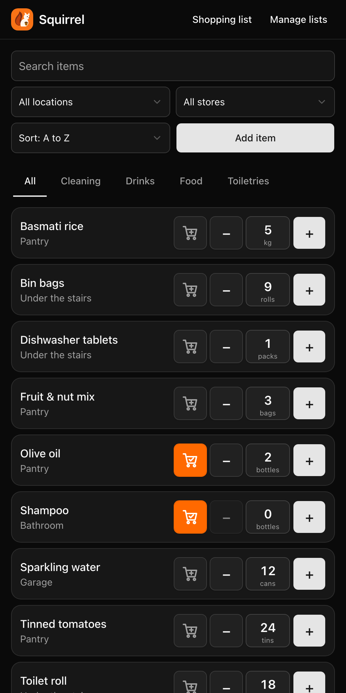

# 🐿️ Squirrel

Squirrel is a small, self-hosted web app that counts the stock in your house.

You buy toothpaste, tinned tomatoes and fruit & nut mix in bulk, and you put it all over the house. Squirrel tells everyone in the household how many of each thing is left. Tap **−1** when you take one out. Tap **+1** when you put one away.

Squirrel does not decide when to buy more. You look at the counts and decide.

<p align="center">
  
</p>

## Features

- A list of items with large **−1** and **+1** buttons, made for one hand on a phone.
- Tap a count to type an exact number.
- Give each item a unit, for example tins, rolls or kg. The default is items.
- Tabs for **All** and for each category, plus search and filters for location and store.
- Sort from A to Z or Z to A, by lowest count first, or by the most recent change.
- A **Shopping list**. Tap the cart on an item to add it. Tap it again when you buy it. The list groups items by store.
- Every change is recorded. See the last 10 changes of an item and **undo** the latest one.
- Categories, locations and stores are lists that you manage in the app.
- Export your items to a CSV file, and import items from one.
- Works on a phone and on a desktop. Add it to your home screen for a full-screen app.
- A read-only JSON API for dashboards and home automation, for example Home Assistant.
- Runs in one small container with one SQLite file, or on Cloudflare Workers with D1. No internet is needed at runtime for the container.

## Security: read this first

> [!WARNING]
> **Squirrel has no login.** Anyone who can reach it can read and change your stock.
> Run it on a trusted home network only.
>
> To use it away from home, put it behind a reverse proxy or tunnel that signs people in. For example, use [Cloudflare Tunnel](https://developers.cloudflare.com/cloudflare-one/connections/connect-networks/) with [Cloudflare Access](https://developers.cloudflare.com/cloudflare-one/policies/access/). Do not open the port to the internet.
>
> A Worker has a public address as soon as you deploy it. Protect it with Cloudflare Access at once. Read [Cloudflare Workers](#cloudflare-workers).

## Quick start

### Docker Compose

Save this as `docker-compose.yml`, then run `docker compose up -d`.

```yaml
services:
  squirrel:
    image: ghcr.io/andrewmooreio/squirrel:latest
    container_name: squirrel
    restart: unless-stopped
    ports:
      - "8080:8080"
    volumes:
      - squirrel-data:/data

volumes:
  squirrel-data:
```

### Docker run

```sh
docker run -d \
  --name squirrel \
  --restart unless-stopped \
  -p 8080:8080 \
  -v squirrel-data:/data \
  ghcr.io/andrewmooreio/squirrel:latest
```

Open <http://localhost:8080>.

### Cloudflare Workers

[](https://deploy.workers.cloudflare.com/?url=https://github.com/andrewmooreio/squirrel)

Click the button. Cloudflare copies the repository to your account and builds it. Wrangler creates the D1 database on the first deploy. Squirrel runs its own migrations on the first request.

> [!WARNING]
> A Worker is public. Squirrel has no login. Add a [Cloudflare Access](https://developers.cloudflare.com/cloudflare-one/policies/access/) policy to the Worker before you use it. Without a policy, anyone who finds the address can change your stock.

To deploy from your own machine instead, run these commands:

```sh
npm ci
npx wrangler login
npm run deploy
```

Static files come from Workers Static Assets, so they do not use Worker CPU time.

### First start

Squirrel starts empty. Before you add an item, open **Manage lists** and create at least one category, one location and one store. Then add your first item.

If your items are in a spreadsheet, import them instead. Read [Import and export](#import-and-export).

## Import and export

Open **Manage lists**, then **Import and export**.

**Export CSV** downloads every item. Use it to move your items to a new install or to edit them in a spreadsheet.

To import, choose a CSV file of 1 MB or less. The first row names the columns:

```csv
name,count,unit,category,location,store,notes
Tinned tomatoes,24,tins,Food,Pantry,Costco,
Bin bags,9,rolls,Cleaning,Under the stairs,Costco,Black ones
```

- `name`, `category`, `location` and `store` are required. `count`, `unit` and `notes` are optional. A blank count is 0. A blank unit is `items`.
- The columns can be in any order. Squirrel ignores other columns.
- Squirrel creates a category, location or store that does not exist yet.
- An import only adds items. If an item with the same name exists, Squirrel skips the row and does not change the item.
- Squirrel also skips a row with a problem, for example a missing category. The result page lists each skipped row with its line number and the reason.

## Configuration

Set these environment variables on the container. All of them are optional.

| Variable       | Default                      | Meaning                                  |
| -------------- | ---------------------------- | ---------------------------------------- |
| `HOST`         | `0.0.0.0`                    | Address to listen on                     |
| `PORT`         | `8080`                       | Port to listen on, from 1 to 65535       |
| `DATABASE_URL` | `sqlite:///data/squirrel.db` | Where Squirrel keeps its data            |

An empty value counts as unset. If you change `PORT`, change the port mapping too. The container runs as a non-root user (UID 65532), so a folder that you mount at `/data` must be writable by that user.

The scheme of `DATABASE_URL` selects the database driver. Version 2.0 has one scheme on Node: `sqlite:`. The path follows the two slashes, so `sqlite:///data/squirrel.db` is the file `/data/squirrel.db`. Squirrel makes the folder if it does not exist.

On Cloudflare Workers there are no environment variables for the database. The D1 binding named `DB` selects it.

### Upgrade from 1.x

Version 2.0 is a rewrite. The app, the URLs, the API and the CSV format stay the same. Two things change:

- The image opens your old SQLite file in place. Keep the same `/data` volume. You do not need to export or import.
- `SQUIRREL_HOST`, `SQUIRREL_PORT` and `SQUIRREL_DB_PATH` are gone. Use `HOST`, `PORT` and `DATABASE_URL`. The defaults are the same, so you only need to change them if you set the old names.

Back up the `/data` volume before you upgrade. Version 2.0 adds a table named `schema_migrations`. Version 1.x ignores it, so you can go back to the old image.

## Image tags

Images are built for `linux/amd64` and `linux/arm64`. They run on a server, a NAS or a Raspberry Pi.

| Tag                 | What it is                                     |
| ------------------- | ---------------------------------------------- |
| `1.2.3`             | One exact release                              |
| `1.2`               | The newest `1.2.x` release                     |
| `1`                 | The newest `1.x.x` release                     |
| `latest`            | The newest release                             |
| `edge`              | The newest commit on `main`, not yet released  |

Only the newest `edge` image is kept. To run an exact commit, build it from source.

To avoid surprises, pin to `1` or `1.2`. Read the [changelog](CHANGELOG.md) before you upgrade. Database changes run by themselves when the container starts.

The version shows at the bottom of every page, for example `v1.1.0`. An `edge` image shows `edge-` and the commit.

## Backups

Squirrel keeps everything in one SQLite file, in WAL mode, in the `/data` volume.

Back up the **whole `/data` volume**, not only `squirrel.db`. In WAL mode, recent changes can be in the `-wal` file next to it.

For the safest backup, stop the container first:

```sh
docker compose stop squirrel
docker run --rm -v squirrel-data:/data -v "$PWD":/backup busybox \
  tar czf /backup/squirrel-backup.tar.gz -C /data .
docker compose start squirrel
```

To restore, stop the container and unpack the archive into the volume.

A [CSV export](#import-and-export) is not a full backup, because it has no history. Back up the `/data` volume for that.

On Cloudflare, export the D1 database: `npx wrangler d1 export squirrel --remote --output squirrel-backup.sql`.

## Health check

`GET /healthz` returns `200 ok` when the database is reachable, and `503` if it is not. The image already uses it for its Docker health check. You can also point your reverse proxy or monitoring at it.

## JSON API

Squirrel has a read-only JSON API. Use it for dashboards and home automation. It cannot change your stock.

> [!WARNING]
> The API has no login, like the rest of Squirrel. Anyone who can reach Squirrel can read it. Read [Security](#security-read-this-first).

| Endpoint                | Returns                      |
| ----------------------- | ---------------------------- |
| `GET /api/items`        | A list of items              |
| `GET /api/items/{id}`   | One item                     |

`GET /api/items` takes these query parameters. All of them are optional.

| Parameter  | Meaning                                                                                   |
| ---------- | ----------------------------------------------------------------------------------------- |
| `q`        | Search in the name                                                                        |
| `category` | A category id, or `none` for items without a category                                     |
| `location` | A location id                                                                             |
| `store`    | A store id                                                                                |
| `sort`     | `name-desc` (Z to A), `count` (lowest first) or `updated` (newest first). Default: A to Z |
| `on_list`  | `1` for items on the shopping list, `0` for items off it                                  |

To find an id, use the main page. Click a category tab, or choose a location or store filter. The address bar then shows the id, for example `?tab=3`, `?loc=2` or `?store=1`. The id of an item is in the address of its page, for example `/items/7`.

```sh
curl 'http://localhost:8080/api/items?sort=count'
```

```json
{
  "items": [
    {
      "id": 1,
      "name": "Tinned tomatoes",
      "count": 3,
      "unit": "tins",
      "category": "Food",
      "location": "Garage",
      "store": "Costco",
      "notes": "",
      "on_list": false,
      "updated_at": "2026-10-05T09:40:33Z"
    }
  ]
}
```

A list field that is blank is `null`. Times are UTC. An empty list is `[]`.

Errors are JSON, for example `{"error":"Not found."}`. An unknown item gives `404`. An id in the path that is not a number also gives `404`. A bad `category`, `location`, `store` or `on_list` parameter gives `400`.

## Development

You need Node.js 24 or later.

```sh
npm ci
npm run dev            # build, then run on :8080 with ./tmp/squirrel.db
npm run dev:worker     # run the Worker locally with Wrangler and a local D1
npm test               # run every test against both drivers
npm run typecheck      # run the TypeScript compiler
npm run lint           # run Biome
npm run build          # build the static files and the Node bundle into ./dist
```

The stack is TypeScript, [Hono](https://hono.dev), server-rendered JSX, [HTMX](https://htmx.org) 4, [Tailwind CSS](https://tailwindcss.com) with [Basecoat](https://basecoatui.com), and SQLite. The core uses only web-standard `Request` and `Response`, so it runs on any host. A small entry module starts it: `src/entry/node.ts` for a container, and `src/entry/worker.ts` for Cloudflare Workers.

The database layer has two parts. A **dialect** holds the SQL text and the migrations for one database family. A **driver** runs that SQL on one runtime. Version 2.0 has one dialect (SQLite) and two drivers: `node-sqlite` for Node, and `d1` for Workers. The core asks a driver for two things only: a query, and an atomic batch of statements. To add a driver, write a module in `src/db/drivers` that implements the `Driver` interface, add its scheme to `src/entry/drivers.ts`, and make it pass `test/conformance.test.ts`.

Commits follow [Conventional Commits](https://www.conventionalcommits.org). Releases and version numbers come from them through [release-please](https://github.com/googleapis/release-please).

## Licence

[MIT](LICENSE)
